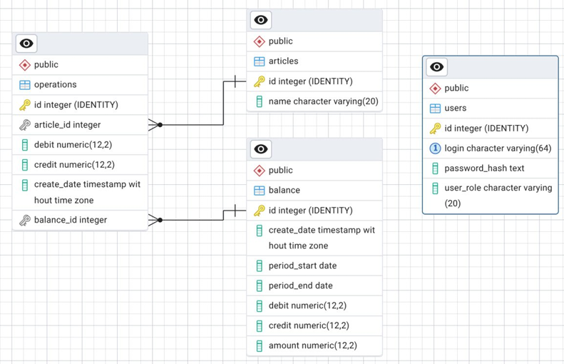

# Система автоматизации ведения домашнего бюджета

Desktop-приложение для ведения финансовой статистики, категоризации операций и анализа денежных потоков. Реализовано в виде клиент-серверной архитектуры с контролем целостности данных на уровне СУБД.

## Функционал приложения
- Учёт доходов и расходов с привязкой к датам и статьям бюджета
- Гибкое управление категориями (статьями) платежей
- Автоматическое формирование ежемесячных балансов и закрытие отчётных периодов
- Разграничение прав доступа (Пользователь / Администратор) с хэшированием паролей
- Встроенная аналитика: динамика потоков, процентное распределение по статьям, график чистой прибыли
- Все расчёты и агрегации вынесены на сторону БД через хранимые процедуры

## Технологический стек
| Компонент | Технология |
|---|---|
| **Язык** | C++ |
| **UI-фреймворк** | Qt 6.9.2 |
| **Система сборки** | CMake |
| **СУБД** | PostgreSQL |
| **ОС разработки** | Alt Linux |

## Архитектура базы данных
### Основные сущности
- `operations` — финансовые операции (приход, расход, дата, ссылка на статью, ссылка на баланс)
- `articles` — статьи бюджета (категория платежа)
- `balances` — ежемесячные отчёты (итоговый приход и расход, чистая прибыль, дата формирования, дата формирования, дата начала учёта операций и окончания учёта)
- `users` — учётные записи (логин, хэш пароля, роль)

### Бизнес-правила на уровне СУБД
**Целостность данных** — использование внешних ключей, строгое соответствие `1 операция → 1 статья → 1 баланс`  
**Транзакционность** — все операции модификации связанных таблиц выполняются в рамках транзакций  
**Триггеры бизнес-логики**:
  - Запрет добавления операций с нулевыми суммами
  - Запрет создания/редактирования операций в закрытых (сформированных) периодах
  - Расформирование баланса требуется для коррекции данных в закрытом месяце

**Хранимые процедуры** — централизованная логика расчёта аналитических показателей

## Клиентское приложение
### Аутентификация и роли
| Роль | Права |
|---|---|
| `Пользователь` | Только просмотр журналов, балансов и аналитики |
| `Администратор` | Полный доступ: CRUD операций/статей, формирование/расформирование балансов |

> Логины и пароли хранятся исключительно в виде криптографических хэшей

### Интерфейсы
- Ввод, редактирование и удаление финансовых операций
- Управление статьями бюджета
- Журнал балансов с кнопками формирования и расформирования отчётного месяца
- Панель аналитики с фильтрами по периоду, выбранным статьям и типом финансового потока

### Визуализация показателей
- Динамика доходов и расходов за произвольный период
- Процентное соотношение финансовых потоков по статьям
- График изменения чистой прибыли бюджета во времени